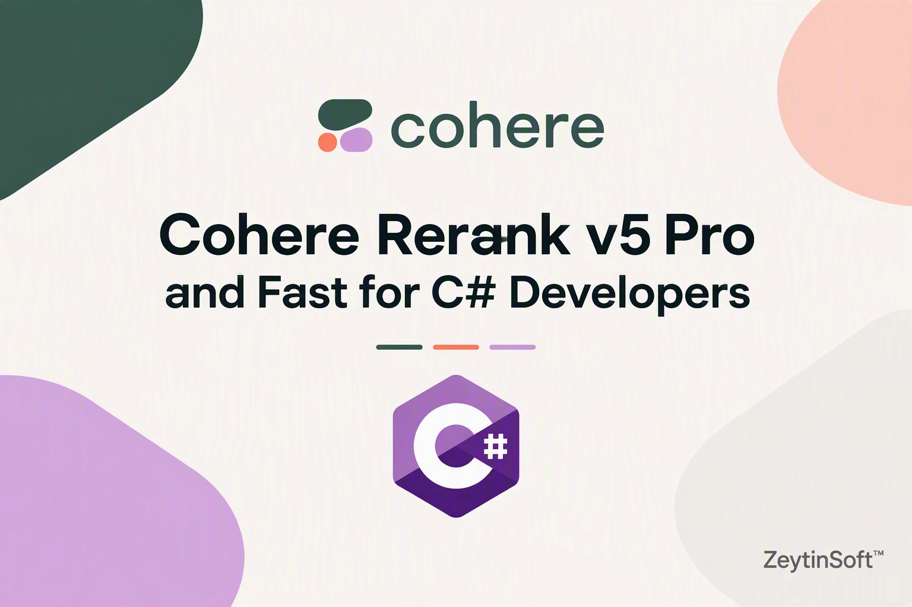

# Cohere Rerank v5 C# Sample


[](https://dotnet.microsoft.com/)
[](LICENSE)


📖 Full walkthrough: [Cohere Rerank v5 Pro and Fast for C# Developers ](https://taswar.zeytinsoft.com/cohere-rerank-v5-pro-and-fast-for-c-developers/)
A .NET 10 console app that calls Cohere Rerank v5 Pro and Fast on Microsoft Foundry. It uses `HttpClient` and Entra ID (Azure Identity) authentication, with no SDK. The app ranks a set of passages against one question, compares the two models, and uses a relevance threshold to decide which passages go to a chat model.

## Why Rerank v5 Matters

- Reorders vector or keyword search results by real relevance to the question, which improves RAG answers
- Returns a calibrated `relevance_score`, so you can drop weak passages instead of always passing the top N
- When no passage clears the threshold, the app answers "I do not know" instead of guessing
- **Pro** gives the most accurate ranking. **Fast** gives lower latency for high-volume or interactive workloads.

## Prerequisites

- [.NET 10 SDK](https://dotnet.microsoft.com/download/dotnet/10.0)
- An Azure subscription with a Microsoft Foundry resource
- `Cohere-rerank-v5-pro` and `Cohere-rerank-v5-fast` deployed on that resource
- Either an API key, or Azure CLI signed in with `az login` (used by `DefaultAzureCredential` locally)
- For Entra ID sign-in, your identity needs the **Cognitive Services User** role on the Foundry resource

## Configuration

Settings are read from user secrets first, then environment variables.

```bash
dotnet user-secrets init
dotnet user-secrets set "COHERE_RERANK_PRO_ENDPOINT" "https://<your-foundry-resource>.services.ai.azure.com"
dotnet user-secrets set "COHERE_RERANK_FAST_ENDPOINT" "https://<your-foundry-resource>.services.ai.azure.com"

# Optional: use an API key instead of Entra ID
dotnet user-secrets set "COHERE_RERANK_PRO_API_KEY" "<your-api-key>"
dotnet user-secrets set "COHERE_RERANK_FAST_API_KEY" "<your-api-key>"
```

| Setting | Required | Purpose |
|---|---|---|
| `COHERE_RERANK_PRO_ENDPOINT` | Yes | Base URL of the Foundry resource that hosts the Pro deployment |
| `COHERE_RERANK_FAST_ENDPOINT` | Yes | Base URL of the Foundry resource that hosts the Fast deployment |
| `COHERE_RERANK_PRO_API_KEY` | No | API key for Pro. If it isn't set, the app signs in with Entra ID. |
| `COHERE_RERANK_FAST_API_KEY` | No | API key for Fast. If it isn't set, the app signs in with Entra ID. |

> **Important:** Set the endpoint to the resource root only, such as `https://<resource>.services.ai.azure.com`. Do **not** add `/models`. The app appends `/providers/cohere/v2/rerank`, which is where Foundry serves Cohere's native Rerank API. With `/models` in the endpoint, the request returns `404 Resource not found`.

> **Note:** Each run calls both models, so set both endpoints. Pro and Fast can be on the same resource or on different ones.

## Usage

```bash
dotnet run
```

The app sends one question and six passages to each model. For each model, it prints the response time and the top 3 passages with their scores. Each passage is marked `keep` or `drop` based on the model's threshold. Sample output:

```
Pro (2331 ms, threshold 0.50)
  0.81  keep  Annual plans can be refunded in full within 30 days of purchase. After 30 days, the remaining months are prorated.
  0.13  drop  Refund requests are submitted from the billing page under Invoices.
  0.06  drop  Monthly plans can be cancelled at any time. The change takes effect at the end of the billing period.
  1 passage(s) passed to the chat model.

Fast (2089 ms, threshold 0.45)
  0.81  keep  Annual plans can be refunded in full within 30 days of purchase. After 30 days, the remaining months are prorated.
  0.06  drop  Refund requests are submitted from the billing page under Invoices.
  0.05  drop  Monthly plans can be cancelled at any time. The change takes effect at the end of the billing period.
  1 passage(s) passed to the chat model.
```

## What the sample shows

| Concept | Where | Details |
|---|---|---|
| Native Cohere v2 request | `RerankAsync` | `POST {endpoint}/providers/cohere/v2/rerank` with `model`, `query`, `top_n` and `documents` |
| API key or Entra ID | `RerankAsync` | Uses a bearer API key if one is set. Otherwise it gets a token for `https://cognitiveservices.azure.com/.default`. |
| Per-model threshold | `ReadModel` | Pro uses `0.50` and Fast uses `0.45`. Tune both against your own data. |
| Grounded fallback | Main loop | If no passage clears the threshold, the app answers "I do not know" instead of passing weak context to the chat model |
| Fixed `Content-Length` | `RerankAsync` | Uses `StringContent` instead of `JsonContent`, so the request isn't sent with chunked encoding |

## Troubleshooting

| Error | Likely cause |
|---|---|
| `404: Resource not found` | The endpoint includes `/models` or another path. Use the resource root only. |
| `404` / `DeploymentNotFound` | The `model` value (`Cohere-rerank-v5-pro` or `Cohere-rerank-v5-fast`) doesn't match a deployment name on the resource |
| `401 Unauthorized` | The API key is wrong, your identity doesn't have the Cognitive Services User role, or Azure CLI is signed in to the wrong tenant |
| `Name or service not known` | The endpoint host is wrong, or DNS or a VPN is blocking it |
| `InvalidOperationException: Set COHERE_RERANK_..._ENDPOINT` | A required setting is missing |

> **Note:** Environment variables override user secrets. If a value you set is ignored, look for an old environment variable with the same name.

## Project structure

```
Program.cs                              Entry point, configuration, and rerank call
Cohere-Rerank-v5-CSharp-Sample.csproj   .NET 10 project and package references
LICENSE                                 MIT license
README.md                               This file
```

## License

This project is licensed under the MIT License. See [LICENSE](LICENSE) for details.
